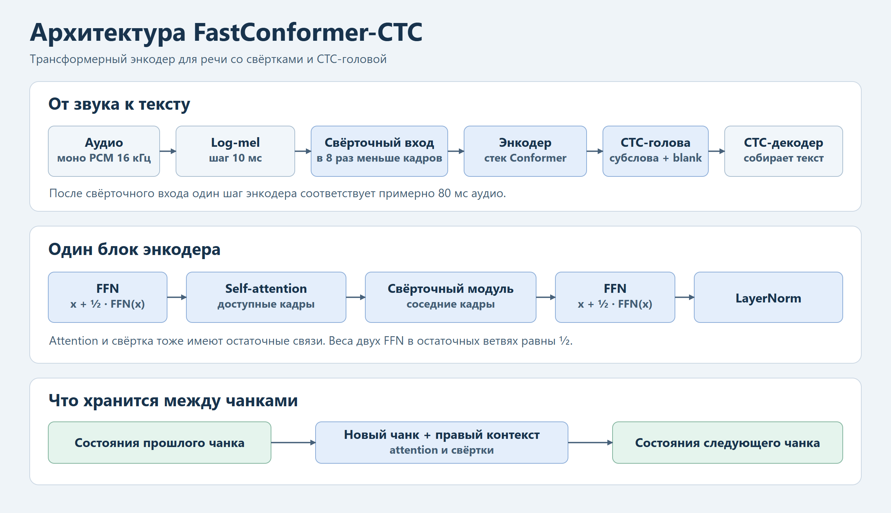
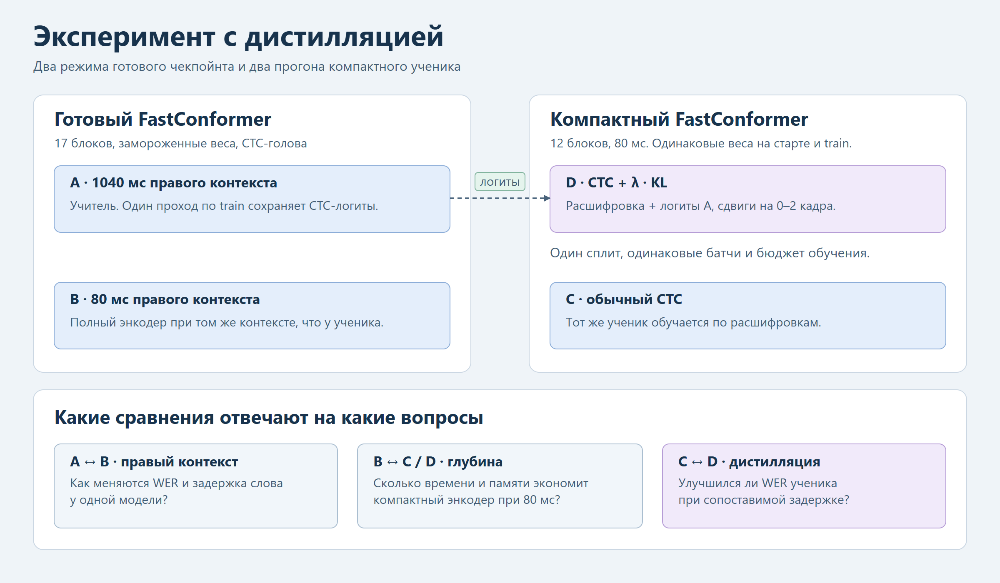

# SpeechRecognitionHT

Мне подсказали что это придётся реализовывать так что я сразу взяла задачу под новенький пк (который я надеюсь приедет). Суть: потоковое распознавание речи

Цель — выводить английские субтитры локально во время речи и проверить, сколько качества можно вернуть компактной модели с коротким правым контекстом за счёт дистилляции. (Не русские потому что русских моделей адекватных сильно меньше)

## 1. Модель и архитектура

Учитель — предобученный NVIDIA FastConformer Hybrid Large Streaming Multi (около 114 млн параметров в гибридном чекпойнте). Про модель даже [статья есть](https://arxiv.org/abs/2305.05084). У гибридного чекпойнта общий энкодер и две головы, CTC и RNN-T. Во всех экспериментах используем CTC.

FastConformer — трансформерный энкодер со свёртками. В одном блоке идут FFN, многоголовое self-attention, свёрточный модуль, ещё один FFN и нормализация. Внимание связывает кадры в доступном контексте, свёртка обрабатывает близкие по времени кадры. Два FFN окружают эти модули и добавляют свои выходы к остаточной ветви с весом ½.

На входе — моноаудио PCM 16 кГц. Log-mel-признаки считаются с шагом 10 мс. Свёрточный вход уменьшает число кадров в 8 раз, поэтому один шаг энкодера соответствует примерно 80 мс аудио. CTC-голова выдаёт на каждом шаге оценки субслов и метки `blank`. При greedy-декодировании выбираем наиболее вероятную метку, схлопываем соседние повторы и удаляем `blank`. Между чанками храним активации для attention и свёрток, а также последнюю сырую CTC-метку, чтобы корректно схлопывать повторы на границах.

Учитель работает в режиме с максимальным правым контекстом 1040 мс. Ученик сохраняет входной тракт, ширину слоёв и токенизатор. Он инициализируется CTC-головой и 12 блоками из 17, равномерно выбранными по глубине учителя. У ученика максимальный правый контекст 80 мс при дообучении и инференсе. Задержку появления слова измеряем отдельно.

## 2. Целевая платформа и ограничения

Целевая платформа — NVIDIA GPU с 16 ГБ VRAM. Инференс проверяем с `batch_size=1` на локальном GPU. WAV подаём в темпе записи, затем проверяем тот же тракт с микрофоном.

Обучение ограничиваем по суммарной длительности аудио в батче. Используем mixed precision, а логиты замороженного учителя считаем заранее и сохраняем на диск. В пилоте измеряем пиковую VRAM и время шага, чтобы подобрать батч и оценить время двух прогонов.

## 3. Основные проблемки

| Участок | Возможное узкое место |
| --- | --- |
| Железо | Со звуком всегда нужно дофига ресурсов так что если вдруг гпу прогорит придётся арендовать. |
| Энкодер | Attention, FFN и свёртки повторяются во всех блоках. Длительность записей увеличивает объём вычислений и активаций. |
| Потоковая обработка | Задержка зависит от того, сколько аудио нужно накопить для обработки чанка, и от времени самих вычислений. При коротких чанках накладные расходы вызовов GPU могут быть заметны. |
| Состояния энкодера | Кэш занимает память и позволяет переиспользовать уже вычисленные состояния. |
| Дистилляция | Учитель делает один проход по обучающей выборке. Чтение сохранённых логитов с диска может снизить пропускную способность обучения. |

## 4. Гипотезы ускорения и компромиссы

- **Сократить энкодер с 17 до 12 блоков.** Ожидаем меньше вычислений на чанк. Удаление слоёв может ухудшить качество, поэтому измеряем скорость и WER при одинаковом максимальном правом контексте.
- **Использовать короткий контекст и кэш состояний.** Короткий контекст позволяет раньше выводить текст и даёт модели меньше информации о следующих звуках. Кэш сокращает повторные вычисления за счёт дополнительной памяти.
- **Вернуть часть качества через `CTC + KL`.** CTC обучается по человеческой расшифровке. Для каждого валидного кадра `t` сравниваем распределение учителя с распределениями ученика на кадрах `t`, `t+1` и `t+2` и берём минимальный KL по доступным кадрам. Это позволяет сопоставить пики CTC, которые возникают в разное время. Проверяем, улучшится ли WER и как изменится задержка вывода слов. На инференсе работает тот же компактный ученик.

## 5. План эксперимента

| Вариант | Блоки | Максимальный правый контекст | Что делаем |
| --- | ---: | ---: | --- |
| A. Учитель | 17 | 1040 мс | Измеряем качество и задержку. Один раз сохраняем CTC-логиты для train. |
| B. Быстрый режим готовой модели | 17 | 80 мс | Измеряем качество, задержку, время вычислений и память. |
| C. Ученик без дистилляции | 12 | 80 мс | Дообучаем с CTC по человеческим расшифровкам. |
| D. Ученик с дистилляцией | 12 | 80 мс | Дообучаем с CTC и KL по логитам учителя. |

A и B показывают эффект правого контекста при тех же весах. Сравнение B с компактными вариантами показывает, сколько времени и памяти экономит компактный энкодер при 80 мс. Главное сравнение — C и D. У них совпадают архитектура, стартовые веса, данные и бюджет обучения, поэтому по ним оцениваем вклад дистилляции в WER и задержку.

1. Запустить полный чекпойнт в режимах 80 и 1040 мс. Проверить частичные субтитры на WAV, воспроизводимом в реальном времени, и снять базовые замеры.
2. Зафиксировать подвыборку на 10 часов из `train-clean-100` LibriSpeech. Закэшировать CTC-логиты учителя в режиме 1040 мс. Подобрать батч по короткому пилоту на локальной GPU.
3. Дообучить двух одинаковых учеников с фиксированным контекстом 80 мс. Первый использует обычный CTC, второй — `CTC + KL` с временным окном. Стартовый бюджет — пять эпох на прогон.
4. Настроить параметры на `dev-clean` и `dev-other`, итоговые метрики снять на `test-clean` и `test-other`. Использовать одинаковое CTC-декодирование для всех вариантов.
5. Записать WER, время обработки чанка, пик VRAM и real-time factor — отношение времени обработки к длительности аудио без пауз воспроизведения. На подвыборке с эталонными временными границами измерить p50/p95 задержки от конца слова до его стабильного появления в субтитрах. Рядом указать долю эталонных слов, для которых удалось посчитать задержку. Показать локальное демо с микрофона.

Источники — [карточка чекпойнта NVIDIA](https://huggingface.co/nvidia/stt_en_fastconformer_hybrid_large_streaming_multi), [FastConformer](https://arxiv.org/abs/2305.05084), [потоковый режим с кэшем](https://arxiv.org/abs/2312.17279), [Delayed-KD](https://arxiv.org/abs/2505.22069), [LibriSpeech](https://www.openslr.org/12/).